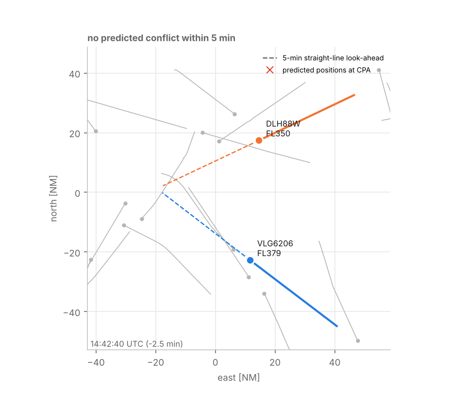
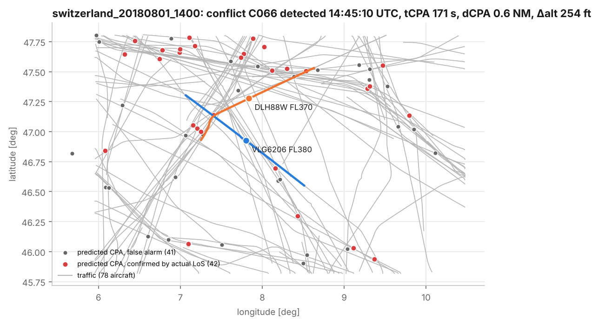
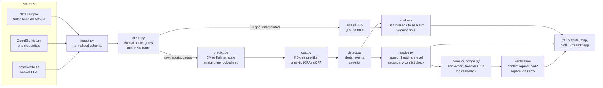
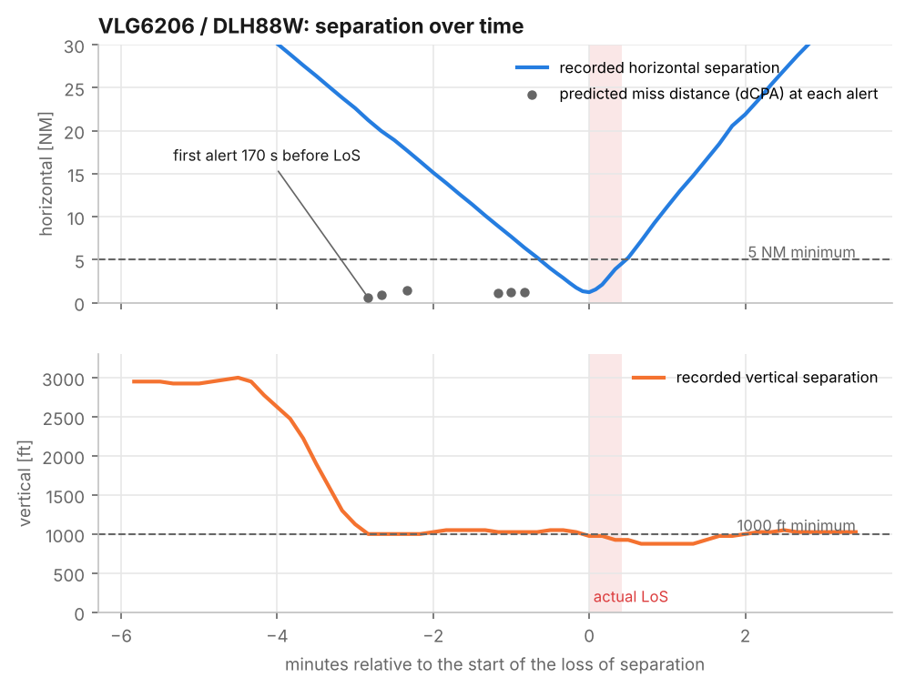
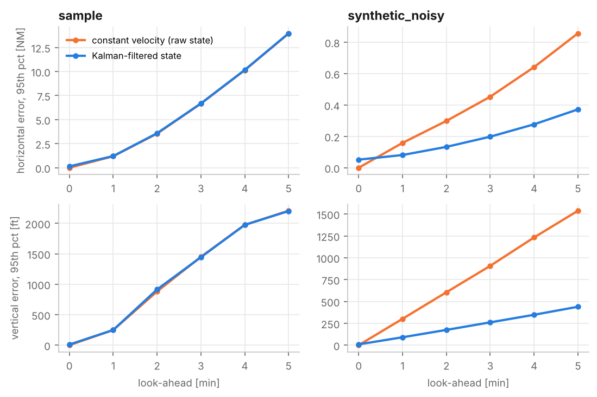
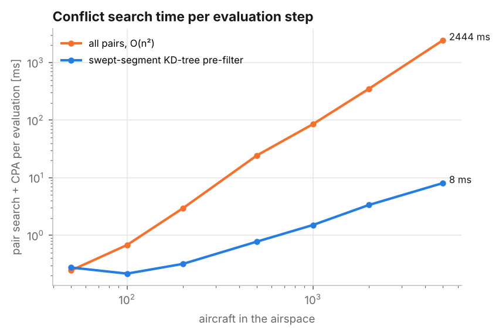
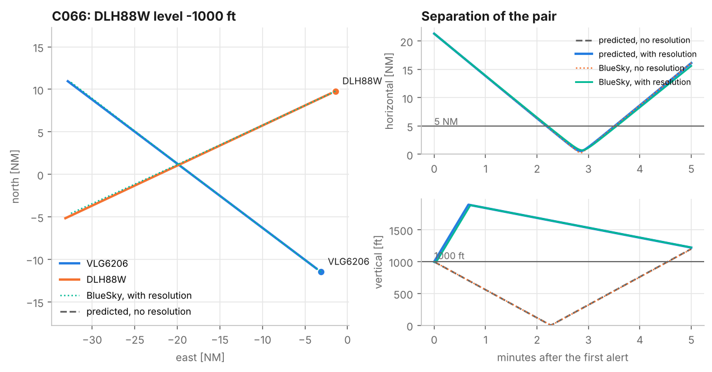
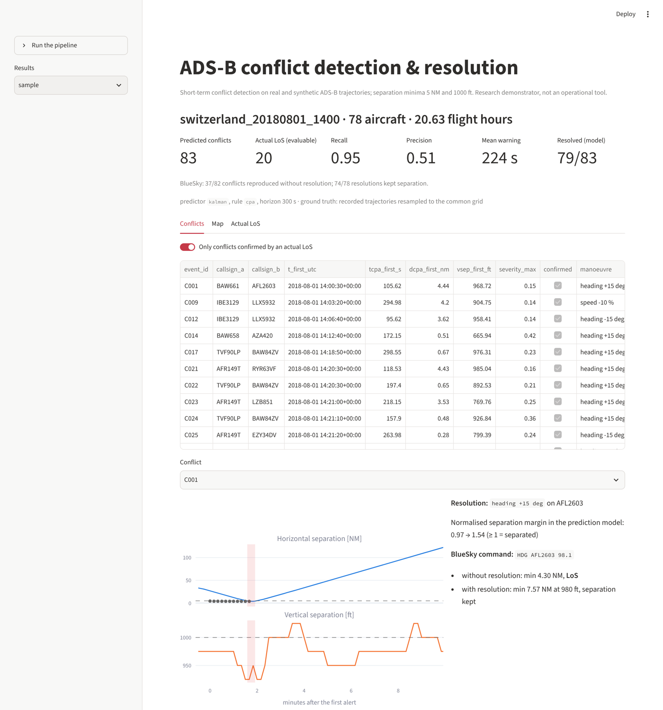

# ADS-B conflict detection and resolution

[](https://github.com/abhishek2993/adsb-conflict-detection/actions/workflows/ci.yml)


Detects potential **losses of separation** between aircraft from real ADS-B
trajectories with a short look-ahead prediction, proposes simple resolution
manoeuvres, and verifies them in the open-source **BlueSky** air traffic
simulator. Separation minima: **5 NM horizontally AND 1,000 ft vertically**.

> Research demonstrator, not an operational tool. See [Limitations](#6-limitations).

---

## 1. Summary



*Real traffic over Switzerland, 1 August 2018. VLG6206 (FL380) and DLH88W,
climbing from FL350 to FL370, cross. Dashed lines are the 5-minute
straight-line look-ahead; red crosses mark the predicted positions at the
closest point of approach (CPA) while an alert is active. The first alert came
170 s before the actual loss of separation.*

The pipeline:

1. **ingests** ADS-B data (committed sample, `traffic` library, OpenSky, or a synthetic generator with known answers);
2. **cleans** it with causal outlier gates and puts every aircraft on a common 5 s grid in a local East-North frame;
3. **predicts** each aircraft's state causally (raw constant-velocity state, or a Kalman-filtered one) and extrapolates it for 5 minutes;
4. computes **tCPA, dCPA and vertical separation at CPA** analytically for candidate pairs from a lossless **KD-tree pre-filter**;
5. **detects** conflicts, scores their severity, and **evaluates** them against the actual losses of separation in the recorded data;
6. **resolves** each conflict with the smallest speed, heading or level change that also avoids new conflicts with third aircraft;
7. **verifies** each encounter in **BlueSky**, headless, with and without the resolution.

Headline results (every number below is produced by
[`scripts/make_docs.py`](scripts/make_docs.py) into
[`docs/results/summary.json`](docs/results/summary.json)):

| | Real sample (78 aircraft, 1 h) | Synthetic, noisy (9 encounters) |
|---|---|---|
| Actual losses of separation (evaluable) | 20 | 6 |
| Detected before they started (recall) | 19 (0.95) | 6 (1.00) |
| Mean / median warning time | 224 s / 260 s | 225 s / 257 s |
| Predicted conflict events / false alarms | 83 / 41 | 8 / 2 |
| CPA tests vs. naive all-pairs | 6,602 vs 79,880 (91.7 % pruned) | 427 vs 681 |
| Resolved in the prediction model | 79 / 83 | 8 / 8 |
| BlueSky: resolution kept separation | 74 / 78 (77 / 78 with a 10 % buffer) | 8 / 8 |



---

## 2. Requirements

### Functional requirements

| ID | Requirement | Verified by |
|---|---|---|
| FR-01 | The system shall ingest ADS-B trajectories (position, barometric altitude, velocity, identity) from the committed sample, the `traffic` library, the OpenSky historical database and the synthetic generator into one schema. | `tests/test_ingest_clean.py` |
| FR-02 | The system shall reject physically impossible reports (implied speed > 700 kt, implied vertical rate > 8,000 ft/min, altitude outside 1,000–50,000 ft), comparing each report only with earlier reports of the same aircraft. | `test_position_and_altitude_spikes_removed` |
| FR-03 | The system shall resample all aircraft to a common time grid (default **5 s**) without interpolating across gaps longer than 60 s. | `test_resample_on_common_grid_without_bridging_gaps` |
| FR-04 | The system shall predict each aircraft's state over a configurable look-ahead horizon (**default 300 s, step 10 s**) with (a) constant-velocity extrapolation of the latest report and (b) a constant-velocity Kalman filter, using only reports available at the evaluation time. | `test_estimates_are_causal` |
| FR-05 | The system shall compute, for each candidate pair at each evaluation time, tCPA, dCPA and the vertical separation at CPA with the analytic relative-motion formula. | `tests/test_cpa.py` (hand-computed cases) |
| FR-06 | **Separation minima:** a loss of separation (LoS) exists when the horizontal distance is **below 5 NM AND** the vertical distance is **below 1,000 ft** at the same time. | `test_in_los_boundaries_and_float_artefact` |
| FR-07 | The system shall flag a predicted conflict when 0 < tCPA ≤ horizon, dCPA < 5 NM and the vertical separation at CPA is below 1,000 ft, and list pair, detection time, tCPA, dCPA, vertical separation and a severity score. | `test_horizontal_threshold_boundary` (4.99 vs 5.01 NM), `test_vertical_threshold_boundary` |
| FR-08 | The system shall find the actual losses of separation in the recorded trajectories and report true positives, missed conflicts, false alarms and warning times. | `test_evaluate_counts_tp_missed_and_false_alarms` |
| FR-09 | The system shall propose, per conflict, the smallest of: speed ±10 %, heading ±15°, flight level ±1,000 ft, heading ±30°, that removes the predicted LoS without creating a new one with any third aircraft. | `tests/test_resolve.py` |
| FR-10 | The system shall export each encounter as BlueSky `.scn` files without and with the resolution, run them headless when BlueSky is installed, read back the logged states and report whether separation is maintained. | `tests/test_bluesky_bridge.py` |
| FR-11 | The system shall provide an interactive map, a separation time series and a before/after resolution plot, and a Streamlit browser for results. | `tests/test_viz.py`, `app/viewer.py` |

### Non-functional requirements

| ID | Requirement | Status |
|---|---|---|
| NFR-01 | Runs offline from committed data; the network is needed only for optional OpenSky downloads (and map tiles in the browser). | met |
| NFR-02 | The pair search shall not scale as naive O(n²); the pre-filter shall not drop any conflict. | met: lossless by construction and by test; 8 ms instead of 2.4 s at 5,000 aircraft (§5.4) |
| NFR-03 | The one-hour sample shall be processed (without BlueSky) in under 30 s on a laptop. | met: about 2 s (clean 0.13 s, predict 0.94 s, detect 0.53 s, resolve 0.28 s) |
| NFR-04 | Deterministic and reproducible: configuration saved with every run; seeded synthetic data. | met (`config.json` in every results folder) |
| NFR-05 | Credentials only from environment variables, never written to disk or the repository. | met (`ingest.fetch_opensky`) |
| NFR-06 | Python 3.11, pinned dependencies, `pip install -e .`, type hints and docstrings, ruff-clean, test coverage > 70 %. | met: 135 tests, 95 % line coverage, CI runs ruff and pytest |

---

## 3. Architecture



| Module | Responsibility |
|---|---|
| `units.py` | NM/ft/kt/fpm conversions, ISA atmosphere, TAS ↔ CAS |
| `geo.py` | WGS84 ↔ local East-North frame |
| `ingest.py` | schema normalisation, scenario I/O, traffic sample builder, OpenSky loader |
| `clean.py` | causal outlier gates, gap-aware resampling |
| `predict.py` | constant-velocity and Kalman state estimation, look-ahead, prediction error |
| `cpa.py` | analytic CPA, LoS interval, the single `in_los` definition, KD-tree pre-filter |
| `detect.py` | conflict alerts, events, severity, actual LoS, evaluation metrics |
| `resolve.py` | manoeuvre ladder, kinematics, secondary-conflict check |
| `bluesky_bridge.py` | `.scn` export, headless BlueSky runs, log parsing and verification |
| `pipeline.py`, `cli.py` | orchestration and command line |
| `viz.py`, `app/viewer.py` | maps, plots, animation, Streamlit browser |

The maths and the reasoning behind every design decision are in
[`docs/LEARNING.md`](docs/LEARNING.md).

---

## 4. Hazard and failure analysis

Each row is a way the input data or the model can mislead the detector, its
effect on the two error types, the mitigation in this project and the
evidence from the runs. A **missed conflict** is the safety-critical error; a
**false alarm** erodes trust.

| # | Hazard | Effect on false alarms | Effect on missed conflicts | Mitigation here | Evidence |
|---|---|---|---|---|---|
| H1 | **Stale or missing ADS-B data** (coverage gaps, dropped messages) | ↑ if a stale state is extrapolated, because an old velocity is projected into the future | ↑ when an aircraft is dropped as stale, or appears too late for any warning | Aircraft with a report older than 30 s are excluded at that evaluation time; no interpolation across gaps > 60 s; the Kalman filter restarts after gaps; LoS where an aircraft was tracked < 60 s beforehand are counted as *not evaluable* rather than missed | 5 of the 25 actual LoS in the sample began less than 60 s after one aircraft entered the data |
| H2 | **Noisy positions and velocities** (NACp/NACv, timing jitter of 10 s state vectors) | ↑: noisy velocity, especially vertical rate, makes the projected CPA cross the thresholds spuriously | ↑ near the boundary: a true 4.5 NM CPA can be estimated at 5.1 NM | Kalman filter on position and reported velocity; causal outlier gates (6 position jumps removed from the sample) | Noisy synthetic set: the Kalman filter cuts the 5-min vertical error p95 from 1,538 ft to 439 ft and false alarms from 3 to 2 at equal recall (§5.2) |
| H3 | **Wrong altitude reference** (barometric vs geometric altitude) | ↑: the two references differ by hundreds of feet with temperature and pressure, so mixing them creates fake vertical conflicts | ↑: the same offset can hide real ones | Barometric (pressure) altitude only, the reference in which flight levels and the 1,000 ft minimum are defined. OpenSky's `baroaltitude` is mapped and `geoaltitude` ignored; scenario metadata records `altitude_reference`. The local frame keeps altitude separate from the ENU Up axis, which would add up to 1.8 km of curvature drop at 150 km | design control; documented in `ingest.py` and `geo.py` |
| H4 | **Turning aircraft** (straight-line prediction is wrong) | ↑ when an aircraft turns *away* from a predicted conflict | ↑ / late alerts when an aircraft turns *into* traffic | Short horizon (5 min); alerts re-evaluated every 10 s so the prediction follows the turn; synthetic `turn_into_conflict` case to measure it | Planned miss 8 NM became an actual 0.15 NM; first alert only 127 s before the LoS, versus 252–278 s for straight crossings and head-ons; real-sample 5-min horizontal error p95 is 13.9 NM, driven by manoeuvres |
| H5 | **Climbs and descents without intent** (the level-off is unknown) | ↑: a climb or descent is projected through an occupied level that the aircraft will never reach | ↓ alerting is early, but only because it is pessimistic | The vertical rate is extrapolated linearly; an optional interval rule catches level crossings the CPA-point rule misses | The README animation: DLH88W was levelling off at FL370 below VLG6206 (FL380) with +284 ft/min still in its state estimate, which projected to 254 ft at the CPA |
| H6 | **Altitude quantisation at RVSM adjacent levels** (25 ft steps, 1,000 ft level spacing) | ↑: level pairs exactly 1,000 ft apart flicker below the threshold | n/a | One `in_los` predicate with a float tolerance; optional level snapping and altimetry-tolerance sensitivity runs | **All 25** actual LoS in the sample are adjacent-level pairs with minimum vertical separation 925–987.5 ft; with an 800 ft threshold the sample has 0 actual LoS, and level snapping cuts the remaining alerts from 40 to 6 (§5.3) |
| H7 | **Model mismatch between resolver and reality** (performance limits, acceleration) | n/a | resolutions that work in the model fail in BlueSky | Bank-angle turn rate, finite acceleration, 1,500 ft/min level changes; optional horizontal buffer | 4 of 78 BlueSky resolutions failed, all speed changes; the 10 % buffer brought it to 1 of 78 (§5.5) |

---

## 5. Evaluation results

All runs use the default configuration (5 NM / 1,000 ft, 300 s horizon,
10 s evaluation step, Kalman predictor, CPA-point rule) unless stated
otherwise. Ground truth for the real sample is the recorded trajectory on the
5 s grid; for the synthetic sets it is `truth.csv` from the noise-free
trajectories.

### 5.1 Datasets

| Scenario | Content |
|---|---|
| `data/sample` | 1 h of en-route traffic over Switzerland (2018-08-01 14:00–15:00 UTC) from the `switzerland` collection bundled with `traffic` (recorded by the OpenSky Network): 79 aircraft and 7,513 reports at 10 s. After cleaning: 78 aircraft, 7,500 reports, 20.6 flight hours, up to 27 aircraft at once. |
| `data/synthetic/noisy` | 9 designed encounters, 1 s reports with 40 m position noise, noisy velocities and 25 ft altitude quantisation. 6 are true losses of separation. |
| `data/synthetic/clean` | The same encounters without noise. |

### 5.2 Detection

Default configuration (Kalman predictor, CPA rule):

| Scenario | Actual LoS | TP | Missed | Alert events | False alarms | Recall | Precision | Mean / median / min warning | False alarms per flight hour |
|---|---|---|---|---|---|---|---|---|---|
| Real sample | 20 | 19 | 1 | 83 | 41 | 0.95 | 0.51 | 224 / 260 / 95 s | 1.99 |
| Synthetic, noisy | 6 | 6 | 0 | 8 | 2 | 1.00 | 0.75 | 225 / 257 / 127 s | 0.56 |
| Synthetic, clean | 6 | 6 | 0 | 6 | 0 | 1.00 | 1.00 | 223 / 257 / 127 s | 0 |

Predictor and rule comparison
([`docs/results/comparison.csv`](docs/results/comparison.csv)):

| Scenario | Predictor | Rule | TP / LoS | Alert events | False alarms | Precision | Mean warning |
|---|---|---|---|---|---|---|---|
| Real sample | constant velocity | CPA | 19 / 20 | 87 | 44 | 0.49 | 219 s |
| Real sample | Kalman | CPA | 19 / 20 | 83 | 41 | 0.51 | 224 s |
| Real sample | constant velocity | interval | 20 / 20 | 101 | 50 | 0.51 | 234 s |
| Real sample | Kalman | interval | 20 / 20 | 94 | 47 | 0.50 | 228 s |
| Synthetic, noisy | constant velocity | CPA | 6 / 6 | 11 | 3 | 0.73 | 221 s |
| Synthetic, noisy | Kalman | CPA | 6 / 6 | 8 | 2 | 0.75 | 225 s |
| Synthetic, noisy | constant velocity | interval | 6 / 6 | 10 | 4 | 0.60 | 266 s |
| Synthetic, noisy | Kalman | interval | 6 / 6 | 9 | 3 | 0.67 | 266 s |

* The **interval rule** (both minima violated at the same instant, solved
  exactly) detects all 20 real-sample losses of separation (CPA-point rule:
  19) and warns about 40 s earlier on the synthetic set, at the cost of more
  alerts.
* The **Kalman filter** reduces false alarms when measurements are noisy and
  barely changes the real-data results, where ADS-B velocities are already
  accurate (see §5.4).
* Every synthetic encounter
  ([`synthetic_encounters.csv`](docs/results/synthetic_encounters.csv)): the
  three clear encounters (6 NM head-on, 7 NM overtake, and the adjacent-level
  crossing with exactly 1,000 ft) are not true conflicts. The first two raise
  no alert; the **two false alarms both come from the adjacent-level
  crossing**, where measured vertical-rate noise projects the pair through
  1,000 ft. The 4.5 NM crossing (estimated 4.53 NM at first alert) is detected
  278 s ahead. The overtake gives only 157 s, because its slow closure means
  the LoS starts long before the CPA.

Look-ahead horizon sensitivity
([`horizon_sensitivity.csv`](docs/results/horizon_sensitivity.csv)), real
sample: 60 s → 18/20 detected, 35 alert events, 43 s mean warning; 120 s →
18/20, 49, 93 s; 180 s → 18/20, 61, 134 s; **300 s → 19/20, 83, 224 s**;
600 s → 19/20, 107, 288 s. Longer horizons buy warning time with alerts.



### 5.3 What the real data contains

**Every one of the 25 actual losses of separation in the Swiss hour is a pair on
adjacent flight levels whose vertical separation dips to between 925 and
987.5 ft** while they pass within 5 NM (closest 0.16 NM). In the RVSM band,
adjacent levels are exactly 1,000 ft apart, so 25 ft altitude quantisation and
altimetry noise decide whether a pair "loses separation". Operationally these
are not incidents. With an altimetry tolerance of 200 ft (threshold 800 ft,
[`configs/altimetry_tolerance_200ft.json`](configs/altimetry_tolerance_200ft.json))
the hour contains **0 actual LoS**, yet the detector still raises
**40 alert events (1.94 per flight hour)**. **36 of them are level pairs**
(both vertical rates below 300 ft/min) on adjacent levels: even 50 ft/min of
estimated vertical rate, extrapolated for 5 minutes, is 250 ft. Treating
vertical rates below 200 ft/min as level
([`configs/level_snap_200fpm.json`](configs/level_snap_200fpm.json)) on top
of the tolerance leaves **6 alert events (0.29 per flight hour)**, 4 of them
with a climbing or descending aircraft, which is where intent is genuinely
missing (hazard H5). The strict 5 NM / 1,000 ft definition stays the default
because it is the requirement. The synthetic set is where the method is
validated against deep, known conflicts.

### 5.4 Prediction accuracy and pair-search scaling



95th-percentile error at 5 minutes look-ahead
([`prediction_errors.csv`](docs/results/prediction_errors.csv)):

| Scenario | Predictor | Horizontal p95 | Vertical p95 |
|---|---|---|---|
| Real sample | constant velocity | 13.94 NM | 2,207 ft |
| Real sample | Kalman | 13.97 NM | 2,201 ft |
| Synthetic, noisy | constant velocity | 0.86 NM | 1,538 ft |
| Synthetic, noisy | Kalman | 0.37 NM | 439 ft |

On noisy measurements the filter cuts the vertical tail error by a factor of
3.5 and the horizontal one by 2.3. On real data the error comes from
manoeuvres (turns, level-offs), which no constant-velocity model can foresee;
the median 5-minute horizontal error there is 1.6 NM.



The swept-segment KD-tree pre-filter
(`python -m conflict_detection benchmark`, random traffic at constant
density) evaluates 5,188 candidate pairs instead of 12.5 million for 5,000
aircraft: **8 ms instead of 2,444 ms** per evaluation step. On the real sample
it removes 91.7 % of the pair tests, and the detections are identical with
and without it (`test_prefilter_gives_identical_detections_on_sample`).

### 5.5 Resolution and BlueSky verification



*Showcased conflict C066: the resolver sends the climbing DLH88W back down 1,000 ft. Left: predicted paths
without (dashed) and with (solid) the manoeuvre, and BlueSky's tracks
(dotted). Right: separation of the pair in the prediction model and in BlueSky.*

| | Real sample | Real sample, 10 % horizontal buffer | Synthetic, noisy |
|---|---|---|---|
| Conflict events | 83 | 83 | 8 |
| Resolved in the prediction model | 79 (95.2 %) | 79 (95.2 %) | 8 (100 %) |
| Manoeuvres chosen | heading ±15°: 47, level ±1,000 ft: 23, speed ±10 %: 9 | heading ±15°: 46, level: 30, speed: 3 | heading: 6, level: 1, speed: 1 |
| Exported / simulable in BlueSky | 83 / 82 | 83 / 82 | 8 / 8 |
| Conflict reproduced in BlueSky without resolution | 37 / 82 | 37 / 82 | 8 / 8 |
| **Resolution kept separation in BlueSky** | **74 / 78 (94.9 %)** | **77 / 78 (98.7 %)** | **8 / 8 (100 %)** |

* **All four failures in the default run were speed changes** accepted with
  a small margin in the model (1.01 to 1.13 × 5 NM). In one case BlueSky's
  A333 envelope capped a +10 % speed increase. Requiring a 10 % horizontal
  buffer ([`configs/robust_resolution.json`](configs/robust_resolution.json))
  removed three of them. The remaining one (C005, −10 % speed) passed at
  4.97 NM and 977 ft in BlueSky for 8 s.
* **Why only 37 of 82 predicted conflicts are reproduced in BlueSky.** BlueSky
  holds level aircraft exactly level. Of the level pairs, 0 of 43 that started
  1,000 ft or more apart lost separation in BlueSky, against 25 of 27 that
  started just below 1,000 ft. All 12 pairs with a climbing or descending
  aircraft were reproduced. The non-reproduced predictions came from
  extrapolating noise-level vertical rates (hazard H6). BlueSky is not a clean
  false-alarm oracle, though: it reproduced 17 of 42 confirmed events and 20
  of 40 false alarms.
* The resolution-success rate is computed over the 78 simulable encounters that
  had a resolution, whether or not BlueSky reproduced the conflict; it answers
  "does the commanded manoeuvre keep the pair separated in an independent simulator?".
* BlueSky ran headless in this repository's environment
  (`bluesky-simulator==1.1.1`, detached mode). The `.scn` files, BlueSky's logs
  and `verification.csv` are written to `results/<run>/bluesky/`.

---

## 6. Limitations

* **No intent information.** Predictions are straight lines; flight plans,
  cleared levels and the ADS-B selected-altitude field are not used. This is
  the main cause of false alarms (descents and climbs that will level off)
  and of late alerts for turning aircraft.
* **No wind.** Ground speed is treated as true airspeed when converting to
  BlueSky's calibrated airspeed, and the resolution kinematics ignore wind.
* **Simplified manoeuvres.** One manoeuvre per conflict, on one aircraft,
  issued immediately, with no pilot or controller delay, no return to route
  and no coordination between simultaneous resolutions.
* **Generic aircraft type in BlueSky.** ADS-B does not report the type; all
  aircraft are simulated as an A333 (highest OpenAP ceiling among common types,
  41,100 ft). Encounters above it are exported but not simulated.
* **Small and benign real dataset.** One hour of well-controlled en-route
  traffic contains no deep losses of separation; deep conflicts are tested
  only with synthetic encounters.
* **Deterministic detection.** No probability of conflict is computed from
  the Kalman covariance; thresholds are hard.
* **Not an operational tool.** No certification, no safety assessment, no
  real-time data link. It demonstrates a method and an evaluation.

---

## 7. How to run

### Install

```bash
git clone https://github.com/abhishek2993/adsb-conflict-detection.git
```

```bash
cd adsb-conflict-detection
```

```bash
python3.11 -m venv .venv && source .venv/bin/activate
```

```bash
pip install -e ".[dev,app,bluesky]"
```

Extras: `dev` (pytest, ruff), `app` (Streamlit), `bluesky` (BlueSky
simulator), `traffic` (rebuild the sample or download from OpenSky).

### Run the pipeline

```bash
python -m conflict_detection run --scenario data/sample --out results/sample
```

Options: `--predictor cv|kalman`, `--rule cpa|interval`, `--horizon 300`,
`--step 10`, `--eval-step 10`, `--resample 5`, `--config configs/<file>.json`,
`--bluesky` (verify in BlueSky), `--no-figures`. Outputs in `results/sample/`:

| File | Content |
|---|---|
| `conflicts.csv` | conflict list: pair, callsigns, first alert (UTC), tCPA, dCPA, vertical separation, severity, CPA location, outcome, chosen resolution |
| `detections.csv` | every alert at every evaluation time |
| `actual_los.csv` | actual losses of separation, detected or missed, warning time |
| `resolutions.csv` | chosen manoeuvre per conflict, margins before and after |
| `metrics.json` | detection metrics, pair-search statistics, cleaning report, timings, BlueSky summary |
| `map.html` | interactive map (trajectories, conflict pairs, predicted CPA points, actual LoS) |
| `figures/` | separation time series (PNG + interactive HTML), before/after resolution plot |
| `bluesky/` | `.scn` files, `manifest.json`, manual-run instructions, `verification.csv` |

Other commands:

```bash
python -m conflict_detection compare --scenario data/sample data/synthetic/noisy
```

```bash
python -m conflict_detection benchmark
```

```bash
python data/synthetic.py
```

### Streamlit viewer

```bash
streamlit run app/viewer.py
```



### BlueSky verification

Headless, from the CLI (BlueSky runs in a child process; about 4 s per
scenario, two scenarios per conflict):

```bash
python -m conflict_detection run --scenario data/sample --out results/sample --bluesky
```

Or with the GUI, by hand:

1. `pip install "bluesky-simulator[full]==1.1.1"` and start `bluesky`.
2. In the BlueSky console: `IC <repo>/results/sample/bluesky/C001_unresolved.scn`, then `FF` to fast-forward. Each scenario stops itself with `HOLD` after 6 minutes.
3. Repeat with `C001_resolved.scn`. Each run writes `CDRLOG_<scenario>_<date>.log` to BlueSky's `output/` folder.
4. Score the logs:

```bash
python -m conflict_detection bluesky-verify --manifest results/sample/bluesky/manifest.json --logs ~/bluesky/output
```

Each scenario switches off BlueSky's own conflict detection and resolution
(`ASAS OFF`, `RESO OFF`), creates both aircraft at their predicted states at
the first alert, issues the resolution command (`HDG`, `SPD` or `ALT`) at
time 0 in the resolved file, and logs `id, lat, lon, alt, tas, gs, trk, vs`
every second.

### OpenSky data (optional)

```bash
export OPENSKY_USERNAME=<user> OPENSKY_PASSWORD=<password>
```

```bash
python -m conflict_detection fetch-opensky --start "2024-05-02 12:00" --stop "2024-05-02 13:00" --bounds 5.9 45.8 10.5 47.8 --out data/opensky/swiss
```

Credentials are read from the environment only and never written to disk.

### Tests and docs

```bash
ruff check . && pytest --cov
```

```bash
python scripts/make_docs.py
```

`make_docs.py` regenerates every figure and number in this README; its
docstring lists the BlueSky runs it reads.

### Repository layout

```
src/conflict_detection/   pipeline package (see §3)
app/viewer.py             Streamlit browser
data/sample/              committed real scenario (parquet)
data/synthetic/           committed synthetic scenarios + truth.csv
data/synthetic.py         synthetic scenario generator script
configs/                  configuration variants used in §5
scripts/make_docs.py      regenerates docs/figures and docs/results
docs/LEARNING.md          derivations and design decisions
tests/                    pytest suite
```

---

## Data and licence

The sample is from the `switzerland` collection bundled with
[`traffic`](https://traffic-viz.github.io/), recorded by the
[OpenSky Network](https://opensky-network.org); see [`data/README.md`](data/README.md)
for citation. Code: [MIT licence](LICENSE).
